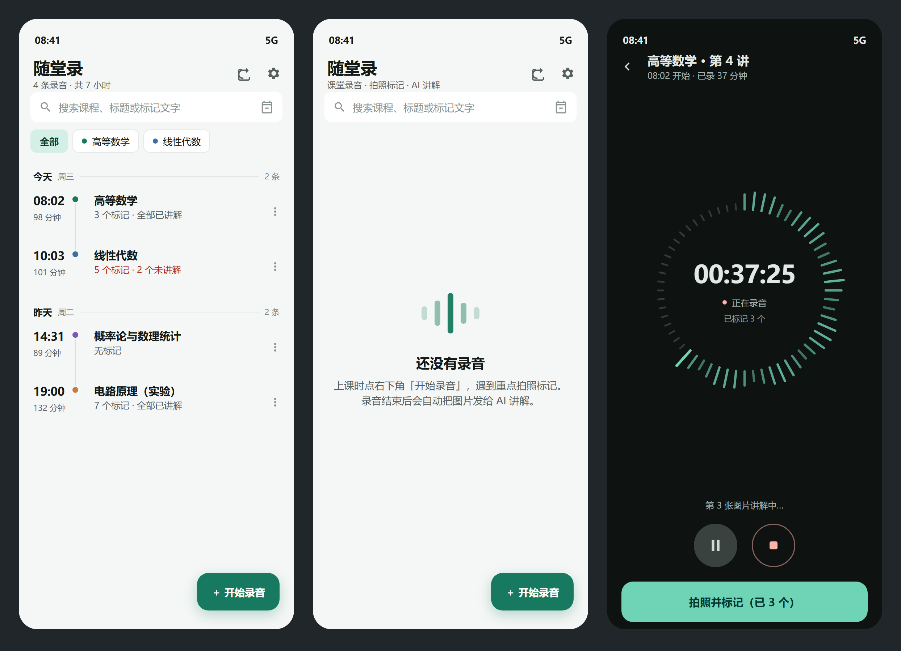
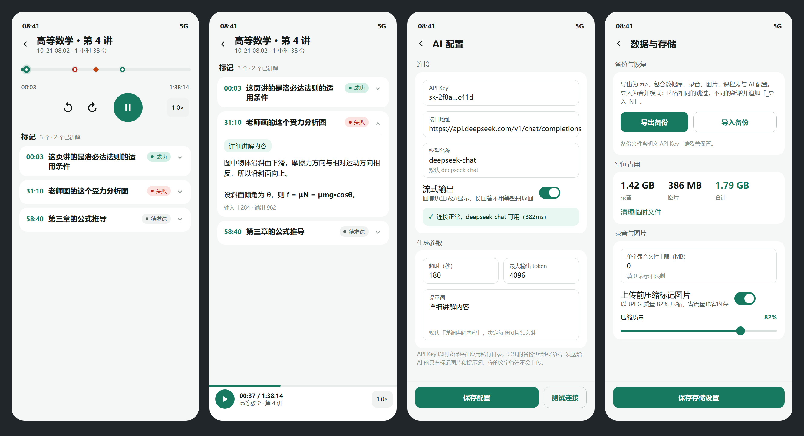
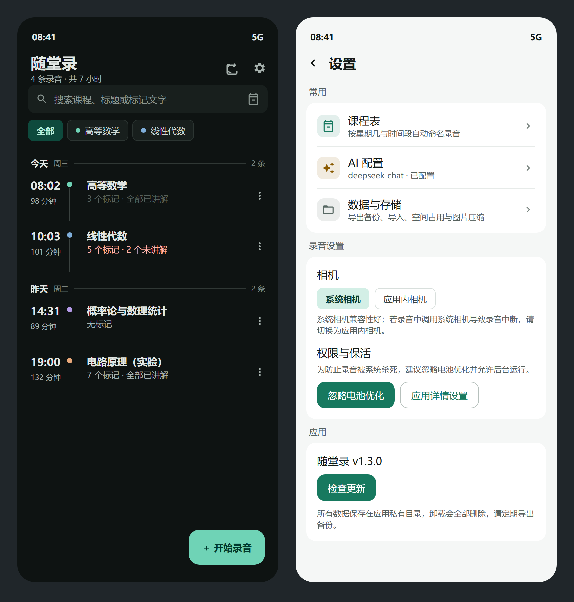

# VoiceNote AI Tutor

**Snap the slide instead of copying it. After class, let the AI walk you through every photo.**




Languages: [简体中文](README.md) | [English](README_EN.md)

---

## What it does

You record the lecture. When the professor writes something worth keeping, you take a photo and keep listening — no more copying the board.

Later, every photo comes with its own AI explanation. The model knows **when** in the lecture you took it and **what note** you attached. Ask follow-ups and it remembers the thread.

```
record ──photo markers──▶ after class ──explain each──▶ follow-up / merge / outline
```

Recordings and photos stay on the device. Images are uploaded to your AI provider only when you ask for an explanation.

## Screens

| Playback: per-marker explanations | Dark mode |
|---|---|
|  |  |

## Features

**Recording**
- Foreground service, keeps going on lock screen and in background; AAC 48kHz stereo
- Auto-pauses on incoming calls / audio focus loss and records the cut point
- Warns once after 60s of silence (phone covered by a book, professor walked away)
- Auto-names recordings from your timetable

**Markers**
- Short press: capture → crop → note. Long press: capture and save, no interruption
- Multiple photos per marker; review what you shot while still recording
- Re-crop after class — the old explanation is invalidated and the marker returns to pending
- "Needs review" star with a filtered view

**AI explanations**
- Each marker is a full conversation: follow-ups, prompt editing, regenerate, stop mid-stream
- **Merge several markers into one request** sharing a single explanation (a slide often takes 2–3 photos)
- Per-marker custom prompts; whole-lecture digest (outline + glossary + three self-test questions)
- Byte-stable request prefix to hit DeepSeek's context cache
- Offline markdown-it + KaTeX rendering for formulas, tables and code
- Per-marker cost estimate (DeepSeek endpoints only, official peak/off-peak rates)

**Direct chat**
- Ask anything or attach photos; the title is auto-generated after the first turn

**Library**
- Timeline home with search across titles, notes, AI answers and follow-ups
- Recycle bin, batch selection, zip backup export/import (SHA-256 verified merge)
- In-app update check

## Quick start

**Install**

Grab `app-release.apk` from [Releases](https://github.com/username-1234567/voice-note-ai-tutor/releases).

> Requires Android 10+. You must add an API key in Settings → AI before photos get explanations.

**Build**

```bash
git clone https://github.com/username-1234567/voice-note-ai-tutor.git
cd voice-note-ai-tutor
./gradlew assembleRelease
```

Open the root folder in Android Studio as an alternative. Signing keys are not in the repo — configure `signing.*` in `local.properties`, or just run a debug build.

**API key**

Defaults to the official DeepSeek endpoint; any OpenAI-compatible `/chat/completions` works. Cost estimates appear only when the model name contains `deepseek`.

## Tech

Kotlin · Jetpack Compose (Material 3) · Room · ExoPlayer · CameraX · uCrop · OkHttp SSE · offline markdown-it + KaTeX in a WebView

Schema is at v5, all upgraded through Room Migrations (the migration logic caused two incidents — both written up in `docs/`).

## Docs

- [Changelog](CHANGELOG.md)
- [Bug review log](docs/2026-10-22-bug复查.md) — 26 issues with root-cause notes

## Limitations

- Not on any app store; build it yourself or use the APK from Releases
- Explanations need a cloud model — images are sent to the provider you configure, no offline mode
- UI is Chinese only
- Backups embed the API key **unencrypted** — clean it before sharing a zip

## Privacy

- Recordings, photos and AI replies live in the app's private storage. No account, no sync. Uninstalling deletes everything
- Marker photos, prompts and notes are sent to the AI provider you configure. Nothing else leaves the device

## Feedback

Open an [issue](https://github.com/username-1234567/voice-note-ai-tutor/issues) for bugs or ideas.

If this saved you from copying the board, a star helps other students find it.

## License

No license declared yet — all rights reserved until a LICENSE file is added.
